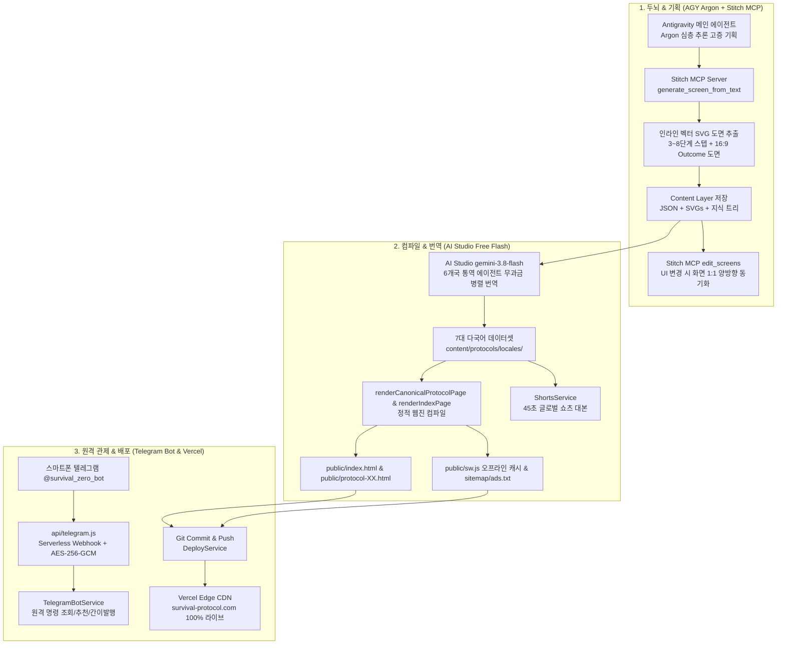

# 생존 교범 (SURVIVAL PROTOCOL) : 원시 생존 매뉴얼 웹진 & 유튜브 쇼츠 파이프라인

## 1. 프로젝트 개요
- **목적**: 인류 문명 붕괴 시 원시 인류가 생존했던 기술을 흑백 브루탈리즘 야전 교본 스타일로 디지털 아카이빙하고, 이를 45초 유튜브 쇼츠 영상으로 원소스 멀티유즈(OSMU) 자동 확장
- **글로벌 다국어 지원 (7대 언어)**:
  - `ko` (한국어), `en` (영어), `ja` (일본어), `es` (스페인어), `de` (독일어), `pt` (포르투갈어), `zh-TW` (중국어 번체)
- **디자인 철학 (Utilitarian Brutalism)**: 
  - Pure Monochrome Brutalism (순수 흑백 피치 블랙, 곡선 배제, 1px/2px 그리드 선화)
  - 직관적 야전 가독성 ([최종 완성 형태 // TARGET OUTCOME] 16:9 도면 ➔ 준비물 체크리스트 ➔ 3~8단계 가변 행동 지침 ➔ 치명적 실수 반전)
  - 비번호 독립 문서 체계 (화면 UI 상 `PR-XX` 일련번호 전면 배제)
  - 듀얼 모드 (야간 전술 다크모드 ↔ 재생지 인쇄 라이트모드)
- **아키텍처**: Content-Driven Layered Component Architecture (10개 스위트 / 70개 단위 테스트 무결성 통과)
- **주제 검증 철학**:
  - 원시 자연물 고증 100% (현대 공산품 일체 배제)
  - 매듭(Knot) 주제 영구 배제 (2D/3D 정적 도면의 야전 혼선 방지 및 직관적 물리 공학 중심 편성)
  - 가변 3~6단계 세부 공학 체계 및 16:9 와이드 완성 결과도(Outcome) 기본 탑재

## 2. 연동 아키텍처 & 데이터 흐름


## 3. 핵심 디렉토리 구조
```text
primitive-survival/
├── content/                     # [Content Layer] 순수 데이터
│   ├── protocols/               # 개별 생존 교범 마스터 JSON (PR-01 ~ PR-N)
│   │   └── locales/             # 6대 타겟 언어 번역 JSON (en, ja, es, de, pt, zh-TW)
│   ├── svgs/                    # 1:1 공용 벡터 기술 도면 (스텝 SVGs + Outcome SVGs)
│   └── knowledge-tree.json      # 문명 복원 지식 그래프 (6대 분과/도메인/티어)
├── src/
│   ├── types/                   # [Type Layer] TypeScript 엄격 규격 단일 SSOT
│   ├── site.config.ts           # 사이트 메타데이터, AdSense, PWA 경로 설정
│   ├── i18n/                    # [i18n Layer] 7대 언어 사전 및 무상태 판별 엔진
│   ├── components/              # [Presentational Layer] 순수 UI 컴포넌트
│   │   ├── layout/              # Header (무상태 i18n 감지), StickyActionBar
│   │   ├── feed/                # FeedHeader, ProtocolCard, Pagination
│   │   └── protocol/            # HeroSection, OutcomePreview, Checklist, StepCard, FatalWarning
│   ├── state/                   # [State Layer] SSOT 런타임 스크립트 직렬화 (0.01초 핫스왑)
│   ├── services/                # [Service Layer] 
│   │   ├── pwa.service.ts       # 결정론적 Service Worker 캐시 해시 생성
│   │   ├── google-drive.service.ts # 구글 드라이브 OAuth2 연동 및 문서 동기화
│   │   ├── svg-audit.service.ts # 5중 루프 가드 & 바운딩박스/텍스트 충돌 감사기
│   │   ├── svg-generator.service.ts # Gemini SVG 합성 및 폴백 생성기
│   │   ├── protocol-generator.service.ts # 3-Wave 병렬 발행 및 원시 고증 검증기
│   │   ├── telegram-bot.service.ts # 텔레그램 봇 인가 제어 및 커맨드 라우터
│   │   ├── deploy.service.ts    # Git 커밋 & 푸시 자동화
│   │   ├── seo.service.ts       # 사이트맵, robots.txt, Schema.org 구조화 데이터
│   │   └── topic-curator.service.ts # 차기 유망 주제 큐레이터
│   ├── gdrive-sync.ts           # 구글 드라이브 문서 동기화 CLI 엔트리
│   ├── render.ts                # 상세 교범 정규 웹 페이지 컴파일러
│   ├── render-index.ts          # 5개 페이징 메인 피드 인덱스 컴파일러
│   └── pipeline.ts              # 전체 빌드 파이프라인
├── api/                         # [Serverless Layer] Vercel 서버리스 웹훅 엔드포인트
│   └── telegram.js              # 텔레그램 웹훅 핸들러 (AES-256-GCM 보안 컨텍스트)
├── public/                      # [Build Artifacts] 최종 배포 번들 (HTML, PWA sw.js, SEO)
├── tests/                       # [Quality Audit] 10개 테스트 스위트 (70/70 단위 테스트 PASS)
└── shorts/                      # 생성된 45초 쇼츠 대본
```

## 4. 품질 및 검수 규격
1. **정적 도면 검수 (SvgAuditService)**:
   - 전 발행 도면(스텝 31종 + 결과물 8종, 총 39종)에 대해 경계 이탈(`BOUNDARY_CLIP`), 텍스트 겹침(`TEXT_OVERLAP`), 문구 깨짐(`TEXT_CORRUPTION`) 100점 만점 통과 필수.
   - 7개국어 전체 SVG `<text>` 노드 개수 및 번역 라벨 바운딩박스 무결성 1:1 일치.
2. **PWA 오프라인 생존성**:
   - 1회 방문 시 전 페이지 HTML, 7개국어 JSON, SVG 벡터 도면 100% 영구 캐시 (`survival-{hash}`).
3. **무과금 하이브리드 경제성**:
   - AGY 스튜디오(Argon) + Stitch MCP + Google AI Studio 무료 티어로 월 추가 API 과금 0원 유지.

## 5. 전담 자동화 스킬 (Antigravity Skills)
1. **`publish-protocol` (신규 포스팅 자율 발행 스킬)**:
   - 기획 ➔ 원시 고증 ➔ 3~6단계 본문 작성 ➔ 3D 벡터 SVG 합성 ➔ 5대 루브릭 QA ➔ 6대 글로벌 언어 번역 ➔ 정적 빌드/PWA 캐시 ➔ **마지막 `sync` 스킬 자동 연계 호출**까지 원스톱 완결.
2. **`sync` (프로젝트 문서 및 클라우드 동기화 스킬)**:
   - 실제 코드베이스와 프로젝트 문서(`PROJECT_SPEC.md`, `README.md`, `NEXT_TOPIC_PROMPT.md`, `implementation_plan.md`) 간 괴리 전수 감사 및 구글 드라이브(`1PMHkwQJsR_MSDjf8cYmJcnGp5wpzVnxW`) 원클릭 자동 동기화.

