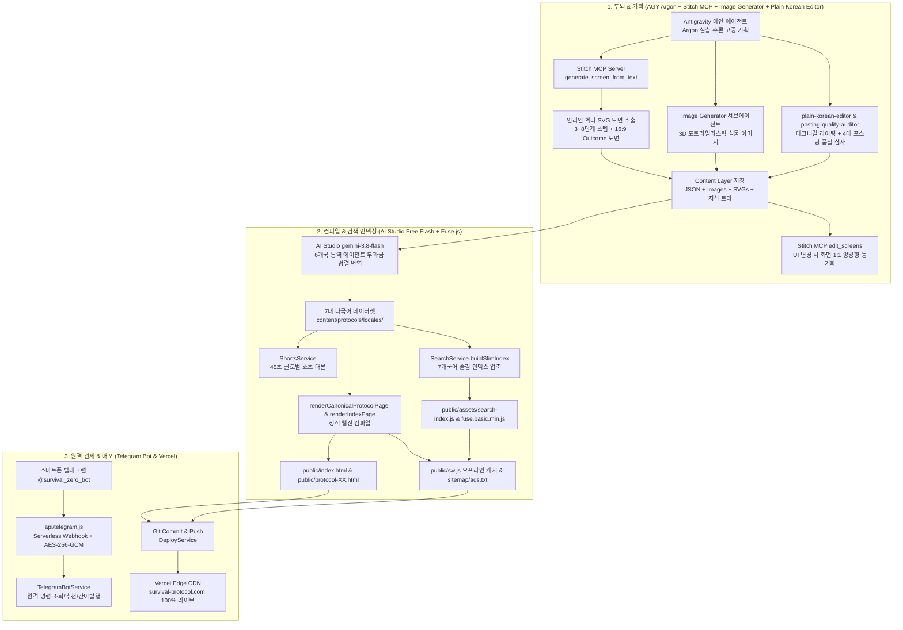

# 포스트 아포칼립스에서 살아남기 (SURVIVAL PROTOCOL) : 실전 생존 매뉴얼 웹진 & 유튜브 쇼츠 파이프라인

## 1. 프로젝트 개요
- **목적**: 인류 문명이 멈춘 포스트 아포칼립스 상황에서 야생 자연물(나무·돌·흙) 및 도시에 버려진 잔해(빈 깡통·안 쓰는 전기선 등)를 활용해 살아남는 기술을 흑백 브루탈리즘 야전 교본 스타일로 디지털 아카이빙하고, 이를 45초 유튜브 쇼츠 영상으로 원소스 멀티유즈(OSMU) 자동 확장
- **글로벌 다국어 지원 (7대 언어)**:
  - `ko` (한국어), `en` (영어), `ja` (일본어), `es` (스페인어), `de` (독일어), `pt` (포르투갈어), `zh-TW` (중국어 번체)
- **디자인 철학 (Utilitarian Brutalism)**: 
  - Pure Monochrome Brutalism (순수 흑백 피치 블랙, 곡선 배제, 1px/2px 그리드 선화)
  - 직관적 야전 가독성 ([최종 완성 형태 // TARGET OUTCOME] 16:9 도면 ➔ 준비물 체크리스트 ➔ 3~8단계 가변 행동 지침 ➔ 치명적 실수 반전)
  - 비번호 독립 문서 체계 (화면 UI 상 `PR-XX` 일련번호 전면 배제)
  - 피드 최신순 기본 정렬 및 최신순/오래된순 정렬 토글 (동적 클라이언트 정렬)
  - 피드 카드 상단 레일 등록일(`YYYY.MM.DD`) 및 상세 히어로 섹션 최종 수정 시간(`YYYY.MM.DD HH:mm`) 표기
  - 독해 시간("소요 30초 독해") 문구 완전 배제 및 모노스페이스 브루탈리즘 제원 스트립 정밀 배치
  - 듀얼 모드 (야간 전술 다크모드 ↔ 재생지 인쇄 라이트모드)
  - 글로벌 통합 푸터 (`Footer.ts`): Stitch Tactical HUD Dark Brutalist 4-컬럼 그리드 규격, 모바일 하단 액션바 오프셋(`pb-20 md:pb-4`), AdSense 4대 규정 링크, 6대 생존 분과 색인 및 CC0 라이선스 스트립 탑재
- **Google AdSense 승인 및 E-E-A-T 신뢰성 4대 규정 페이지 (Stitch 1:1 완벽 이식)**:
  - `about.html`: 4대 엄격 실증 체계 (Zero-Tool, Vector Blueprint, Red-Team Safety, PWA Offline), 수석 편찬 위원회(인류학/열역학 공학), CC0 오픈소스 배포 헌장
  - `privacy.html`: Zero-PII 수집 헌장, Google AdSense 맞춤 쿠키 및 옵트아웃(`adssettings.google.com`), GA4 IP 비식별화, Firebase 원자적 증분 텔레메트리, PWA 로컬 스토리지 즉시 소각(`executeHardPurge()`)
  - `terms.html`: 재난 대비 생존 교육 및 야전 안전 면책 조항, 공공 비영리 목적, 고위험 야전 실습 면책, 생존 결과 무보증 원칙, 현행 산림보호법 준수 의무
  - `contact.html`: 비상 통신 및 야전 기술 제보 레지스트리, PGP 암호화 서신, 공식 GitHub 이슈/PR, 긴급 텔레그램 채널, 야전 정오표(Errata) 보고서 양식
- **클라이언트 인메모리 초고속 검색 & 초성 탐색 엔진**:
  - `Fuse.js` 및 순수 유니코드 연산 초성 분해 엔진(`hangul.util.ts`) 탑재로 0ms 초고속 반응 속도 구현
  - 한글 자음 초성(`ㅅㅅ` -> 식수, `ㅂㅇ` -> 바위, `ㅈㅅㄱ` -> 정수기) 및 완성형 키워드 하이브리드 퍼지 매칭
  - 다차원 싱글톤 인스턴스 캐싱(`fuseCache[lang + '_' + mode]`) 및 한글 IME 조합 중 Enter 방어
  - 외장 번들(`public/assets/search-index.js`) 분리로 페이지당 HTML 275KB 감축 및 PWA SW 영구 프리캐시
  - 택티컬 옐로우(`#fde68a`) 하이라이팅, 35자 스니펫 및 키보드 단축키(`Cmd+K`, `/`, `ESC`, `ArrowUp/Down`) 완비
- **아키텍처**: Content-Driven Layered Component Architecture (15개 스위트 / 140개 단위 테스트 무결성 100% 통과)
- **주제 검증 및 문체 감수 철학**:
  - 듀얼 트랙 생존 고증 (Track A: 순수 자연물 원시 공학 / Track B: 포스트 아포칼립스 도시 폐자재 업사이클링 공학)
  - 초등학생(11~13세) 눈높이 직관성 & 가독성 100% 보장 (`plain-korean-editor` 에이전트 & `PlainKoreanEditorService` 파이프라인 탑재)
    - 난해한 학술·전문 용어(다공성, 흡착, 비등 멸균, 플러싱 등) 전면 배제 및 일상 친화 구어체 표준화
    - 숫자에 신체 감각 비유 병기(콩알 크기, 손가락 두~네 마디 높이 등) 및 직관적 이유 즉시 제시
  - **4대 심층 포스팅 품질 리뷰 (`PostingReviewService` & `posting-quality-auditor`)**:
    - ① 야전 안전 & 오남용 Red-Team 심사, ② 자·저울·타이머 없는 무도구 신체·오감 재현성 검증, ③ 구글 검색엔진 E-E-A-T & HowTo 구조화 데이터 정합성, ④ 6대 언어 생태계 대응 현지화 검수
  - 매듭(Knot) 주제 영구 배제 (2D/3D 정적 도면의 야전 혼선 방지 및 직관적 물리 공학 중심 편성)
  - 가변 3~6단계 세부 공학 체계 및 16:9 와이드 완성 결과도(Outcome) 기본 탑재
  - 3D 포토리얼리스틱 실물 이미지 에셋(Image Generator)과 벡터 SVG의 하이브리드 지원
  - 실질 콘텐츠 SHA-256 지문 기반 타임스탬프 영속화 엔진 (`npm run sync:timestamps`)

## 2. 연동 아키텍처 & 데이터 흐름


## 3. 핵심 디렉토리 구조
```text
primitive-survival/
├── content/                     # [Content Layer] 순수 데이터
│   ├── protocols/               # 개별 생존 교범 마스터 JSON (PR-01 ~ PR-16, 총 15편)
│   │   └── locales/             # 6대 타겟 언어 번역 JSON (en, ja, es, de, pt, zh-TW)
│   ├── images/                  # 3D 포토리얼리스틱 실물 및 야전 식생·폐자재 식별 에셋 (pr08-*.jpg, id-*.jpg 총 18종)
│   ├── svgs/                    # 1:1 공용 벡터 기술 도면 (99개 SVG 도면, 활성 감사 85종)
│   └── knowledge-tree.json      # 문명 복원 지식 그래프 (6대 분과/도메인/티어)
├── src/
│   ├── types/                   # [Type Layer] TypeScript 엄격 규격 단일 SSOT
│   ├── site.config.ts           # 사이트 메타데이터, AdSense, PWA 경로 설정
│   ├── i18n/                    # [i18n Layer] 7대 언어 사전 및 무상태 판별 엔진
│   ├── components/              # [Presentational Layer] 순수 UI 컴포넌트
│   │   ├── layout/              # Header, StickyActionBar, SearchModal, Footer (글로벌 4-컬럼 HUD 푸터)
│   │   ├── feed/                # FeedHeader, ProtocolCard, Pagination
│   │   └── protocol/            # HeroSection, OutcomePreview, Checklist, StepCard, FatalWarning
│   ├── state/                   # [State Layer] SSOT 런타임 스크립트 직렬화 (0.01초 핫스왑)
│   │   ├── search.state.ts      # Fuse.js 인스턴스 싱글톤 캐시, IME 방어, 키보드 단축키 런타임
│   │   ├── feed.state.ts        # 동적 피드 페이징 및 정렬 상태 관리
│   │   └── locale.state.ts      # 7개국어 0.01초 무새로고침 핫스왑 엔진
│   ├── services/                # [Service Layer] 
│   │   ├── search.service.ts    # 슬림 인덱스 빌드, Fuse 퍼지 검색, 택티컬 하이라이팅
│   │   ├── posting-review.service.ts # 4대 심층 포스팅 품질 감수 엔진 (안전, 무도구 재현성, SEO, 글로벌 현지화)
│   │   ├── content-enrichment.service.ts # 문맥 하이퍼텍스트 크로스링커 & 콘텐츠/벡터/실사 보강 감수 엔진
│   │   ├── pwa.service.ts       # 결정론적 Service Worker 캐시 해시 생성
│   │   ├── google-drive.service.ts # 구글 드라이브 OAuth2 연동 및 문서 동기화
│   │   ├── svg-audit.service.ts # 5중 루프 가드 & 바운딩박스/텍스트 충돌 감사기
│   │   ├── svg-design-auditor.service.ts # 기계공학 유클리드 좌표 공차 & 멀티모달 비전 감수기
│   │   ├── svg-generator.service.ts # Gemini SVG 합성 및 폴백 생성기
│   │   ├── protocol-generator.service.ts # 3-Wave 병렬 발행, 고증 검증 및 눈높이 감수 연동
│   │   ├── plain-korean-editor.service.ts # 초등학생 눈높이 문체 감수 및 난해어 자동 교정기
│   │   ├── telegram-bot.service.ts # 텔레그램 봇 인가 제어 및 커맨드 라우터
│   │   ├── deploy.service.ts    # Git 커밋 & 푸시 자동화
│   │   ├── seo.service.ts       # 사이트맵, robots.txt, Schema.org 구조화 데이터
│   │   └── topic-curator.service.ts # 차기 유망 주제 큐레이터
│   ├── utils/
│   │   ├── hangul.util.ts       # 유니코드 초성 분해(0.0001ms), NFD 호환 정규화 유틸
│   │   ├── svg-renderer.ts      # 고해상도 SVG-to-PNG 렌더링 유틸
│   │   └── protocol-timestamp.ts # Git 커밋 및 실질 콘텐츠 SHA-256 해시 기반 타임스탬프 동기화 유틸
│   ├── policy-content.ts        # Stitch 1:1 규격 4대 정책 페이지 원시 본문 마크업
│   ├── render-policy.ts         # Google AdSense 4대 규정 페이지(About, Privacy, Terms, Contact) 정적 컴파일러
│   ├── gdrive-sync.ts           # 구글 드라이브 문서 동기화 CLI 엔트리
│   ├── render.ts                # 상세 교범 정규 웹 페이지 컴파일러
│   ├── render-index.ts          # 5개 페이징 메인 피드 인덱스 컴파일러
│   └── pipeline.ts              # 전체 빌드 파이프라인
├── api/                         # [Serverless Layer] Vercel 서버리스 웹훅 엔드포인트
│   └── telegram.js              # 텔레그램 웹훅 핸들러 (AES-256-GCM 보안 컨텍스트)
├── public/                      # [Build Artifacts] 최종 배포 번들 (HTML, {about,privacy,terms,contact}.html, assets/search-index.js, sw.js)
├── tests/                       # [Quality Audit] 15개 테스트 스위트 (140/140 단위 테스트 100% PASS)
├── scripts/                     # [CLI Scripts] sync-timestamps.ts, audit-svg-design.ts, serve.ts 등
└── shorts/                      # 생성된 45초 쇼츠 대본
```

## 4. 품질 및 검수 규격
1. **정적 도면 및 에셋 검수 (SvgAuditService)**:
   - 전 발행 도면(총 99종, 활성 정적 감사 85종)에 대해 경계 이탈(`BOUNDARY_CLIP`), 텍스트 겹침(`TEXT_OVERLAP`), 문구 깨짐(`TEXT_CORRUPTION`) 100점 만점 통과 필수.
   - 7개국어 전체 SVG `<text>` 노드 개수 및 번역 라벨 바운딩박스 무결성 1:1 일치.
   - 고화질 실물 이미지(`content/images/`)와 벡터 도면의 상호보완 렌더링 검증.
2. **수석 기계공학 벡터 축 및 비전 감수 (SvgDesignAuditorService & `svg-design-auditor`)**:
   - 기계공학 유클리드 기하학 공차 검증: 상단 힌지 결합 이격 거리 $\le 2.0\text{px}$, 하단 걸림턱 결합 이격 거리 $\le 2.0\text{px}$, 빗장대 지지각 $45^\circ \pm 5^\circ$.
   - 고해상도(1000px) SVG-to-PNG 렌더링 기반 제미나이 멀티모달 비전 정밀 감수 및 자가 치유(Self-Healing) 좌표 교정.
   - 전용 독립 실행 CLI 제공: `npm run audit:svg-design [protocolId]`.
3. **전문 테크니컬 라이팅, 인라인 크로스링킹 & 콘텐츠 심층 보강 감수 (`PlainKoreanEditorService`, `PostingReviewService`, `CrossLinkerService`, `ContentEnrichmentService`)**:
   - 유아어/동화풍 표현(Fluff) 및 난해한 학술 용어(Jargon) 동시 100% 배제.
   - 1문장 1행동 번호형 액션 체크리스트(`01`, `02`) 및 핵심 수치 하이라이팅(`#fde68a`, `#ffffff`) 규격화.
   - **문맥 하이퍼텍스트 상호 링킹 (`protocol-cross-linker` / `CrossLinkerService`)**: 본문 및 준비물 설명 도중 연관된 다른 프로토콜(예: 송진 채취 시 `[돌칼이나 돌도끼](/protocol-04.html)`, 경화제 `[참나무 숯가루](/protocol-09.html)`, 돌도끼 결속 시 `[야생 칡덩굴 밧줄](/protocol-05.html)`)을 찾아 인라인 하이퍼텍스트 배지(`↗`)로 즉시 이동 가능하게 연결.
   - **콘텐츠 깊이·벡터 밀도·실사 도감 보강 감수 (`content-enrichment-auditor` / `ContentEnrichmentService`)**: 내용의 의미성과 쉬운 인과 설명 여부 검수, 스텝별 벡터 도면 밀도 가감(`NEEDS_EXTRA_VECTOR` 추가 요청 vs `OVERDONE_PRUNE_CANDIDATE` 과잉 감축), 그리고 헷갈리는 수종/자재에 대한 실사 도감(`FieldIdentificationSpec`) 보강 판정.
   - **4대 심층 포스팅 리뷰 통과 (`posting-quality-auditor`)**: ① 야전 안전 Red-Team 심사, ② 무도구 신체·오감 재현성 검증, ③ 구글 검색엔진 E-E-A-T & HowTo 구조화 데이터 정합성, ④ 6대 언어 생태계 현지화 검수 (`tests/16_posting_review_engine.test.ts`).
4. **타임스탬프 및 콘텐츠 해시 정밀 동기화 (`protocol-timestamp.ts`)**:
   - 실질 콘텐츠 SHA-256 해시 지문 기반으로 SVG/이미지/텍스트 변경 시에만 `updatedAt`이 갱신되는 멱등성 보장 (`npm run sync:timestamps`).
5. **클라이언트 인메모리 검색 엔진 무결성 (`search.service.ts`, `search.state.ts`)**:
   - 50회 연속 검색 시 평균 5ms 이내의 서브 밀리초 고속 탐색 및 0건 누락 보장.
   - 한글 음절(NFC) 및 자소 분리(NFD) 입력에 대한 초성 분해/판별 100% 호환.
   - XSS 방어(HTML 태그 이스케이프) 및 외장 인덱스 번들(`search-index.js`) SW 사전 캐시 정합성.
6. **PWA 오프라인 생존성**:
   - 1회 방문 시 전 페이지 HTML, 7개국어 JSON, SVG 벡터 도면, 실물 이미지, 검색 인덱스(`search-index.js`) 및 Fuse 스크립트 100% 영구 캐시 (`survival-{hash}`).
7. **무과금 하이브리드 경제성**:
   - AGY 스튜디오(Argon) + Stitch MCP + Google AI Studio 무료 티어로 월 추가 API 과금 0원 유지.

## 5. 전담 자동화 스킬 (Antigravity Skills)
1. **`publish-protocol` (벡터 도면 기반 신규 포스팅 자율 발행 스킬)**:
   - 기획 ➔ 원시 고증 ➔ 초등학생 눈높이 3~6단계 본문 작성 ➔ 3D 벡터 SVG 합성 ➔ 5대 루브릭 QA ➔ 6대 글로벌 언어 번역 ➔ 정적 빌드/PWA 캐시 ➔ **마지막 `sync` 스킬 자동 연계 호출**까지 원스톱 완결.
2. **`publish-protocol-image` (고화질 실물 이미지 기반 신규 포스팅 자율 발행 스킬)**:
   - 제미나이 고화질 실물 이미지(`image-generator` 서브에이전트) 기반 신규 생존 프로토콜 발행 파이프라인(주제 기획 ➔ 원시 고증 & 초등학생 눈높이 쉬운 본문 ➔ 3D 포토리얼리스틱 이미지 생성 ➔ 6대 글로벌 언어 번역 ➔ 정적 빌드/PWA 캐시 ➔ `sync` 스킬 자동 연계 호출) 원스톱 완결.
3. **`sync` (프로젝트 문서 및 클라우드 동기화 스킬)**:
   - 실제 코드베이스와 프로젝트 문서(`PROJECT_SPEC.md`, `README.md`, `NEXT_TOPIC_PROMPT.md`, `implementation_plan.md`) 간 괴리 전수 감사 및 구글 드라이브(`1PMHkwQJsR_MSDjf8cYmJcnGp5wpzVnxW`) 원클릭 자동 동기화.

