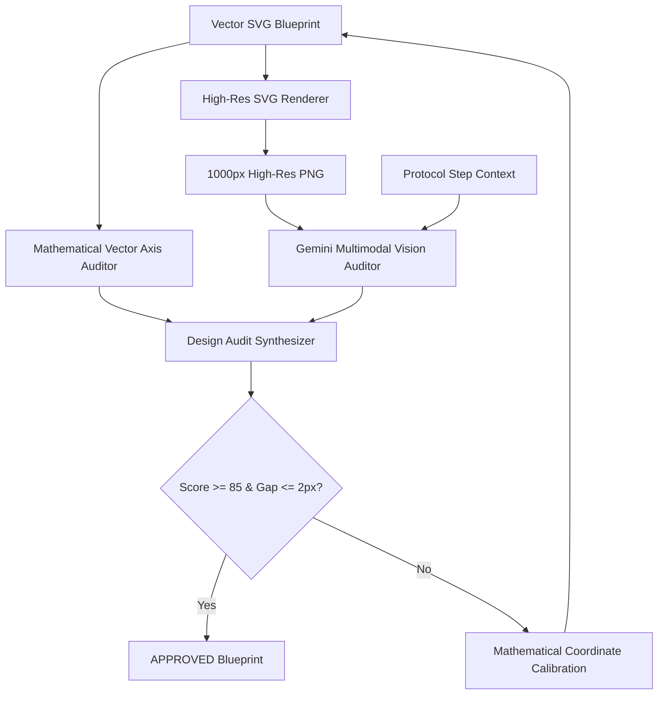

# Implementation Plan: Visual & Mathematical Vector Blueprint Design Audit Agent

## 1. Background & Problem Statement
- **Issue**: In Protocol 08 (Figure-4 Deadfall Trap) and other primitive blueprints, mechanical axes, hinge contacts, and catch notches between interlocking sticks do not align precisely (e.g., in Step 3, the bottom tip of Stick 2 is at y=235 while Stick 3's catch notch is at y=195, leaving a 40px floating gap).
- **Goal**: Create an expert **Mechanical & Visual Vector Blueprint Design Auditor (`svg-design-auditor`)** combining:
  1. **Mathematical Euclidean Axis Checking**: Contact gap distance $\le 2\text{px}$, joint axis intersection, and $\pm 5^\circ$ angle verification.
  2. **Multimodal Vision Inspection**: Rendering SVGs to high-res PNG and auditing with Gemini Vision against step descriptions.
  3. **Self-Healing Calibration**: Automatically calculating exact delta coordinates and repairing blueprints.
  4. **Dual Workflow Support**: Integrated into the publishing pipeline and available via dedicated CLI (`npm run audit:svg-design`).

---

## 2. Architecture & Components

---

## 3. Detailed Tasks & Steps

### Phase 1: Core Engine & Subagent Setup
1. **Multimodal Gemini Client**:
   - Enhance `src/gemini-client.ts` to support image inlineData (`image/png` base64).
2. **SVG-to-PNG Renderer**:
   - Create `src/utils/svg-renderer.ts` using macOS `qlmanage` / headless rendering for instantaneous high-res PNG generation.
3. **Design Auditor Service**:
   - Create `src/services/svg-design-auditor.service.ts`:
     - Mathematical contact gap & angle tolerance checker.
     - Multimodal Gemini Vision audit method.
     - Unified scoring & remediation prompt generator.
4. **Subagent Specification**:
   - Create `.agents/agents/svg-design-auditor/agent.md`.
5. **CLI Script**:
   - Add `scripts/audit-svg-design.ts` and script `npm run audit:svg-design` to `package.json`.

### Phase 2: Calibration of Protocol 08 Blueprints
1. Inspect and measure coordinate gaps in:
   - `pr08-step-01.svg` (Stick carving shapes)
   - `pr08-step-02.svg` (Hinge alignment at top chisel)
   - `pr08-step-03.svg` (Close the 40px gap between Strut bottom and Bait stick notch)
   - `pr08-step-04.svg` (Align rock resting contact and bait stick trigger axis)
   - `pr08-outcome.svg` (Align full 16:9 assembly axes)
2. Calibrate all SVG coordinates so that contact gaps are $\le 2\text{px}$ and mechanical angles match description.
3. Verify 7-language label counts and ordering.

### Phase 3: Verification & Deployment
1. Write unit tests in `tests/12_svg_design_auditor.test.ts`.
2. Run `npm test` (all tests pass).
3. Run `npm run build` (PWA and static files updated).
4. Commit, push to `origin/main`, and run `npm run gdrive:sync`.

### Phase 4: Protocol 09 (Pit Charcoal Kiln) Autonomous Publishing [COMPLETED]
1. [x] Plain Korean Master Protocol: `09-pit-charcoal-kiln.json`
2. [x] 3D Vector Technical SVGs: `pr09-step-01.svg` ~ `pr09-step-04.svg` and `pr09-outcome.svg` (all 100/100 by `svg-blueprint-auditor`)
3. [x] 6 Global Languages Localized: `locales/09-pit-charcoal-kiln.{en,ja,es,de,pt,zh-TW}.json` with 1:1 SVG label synchronization
4. [x] Engine Timestamp & Content Hash: `sync:timestamps` executed with first hash `3c80e0f8743ccff6` registered
5. [x] Full Verification: 12 test suites / 86 tests 100% passing
6. [x] Chained Sync: `knowledge-tree.json`, `PROJECT_SPEC.md`, `README.md`, `NEXT_TOPIC_PROMPT.md` (PR-10 planned) updated

### Phase 5: Elementary-School Grade Plain Korean Editor & PR-01 Reposting [COMPLETED]
1. [x] Plain Korean Editor Agent & Service:
   - Created `.agents/agents/plain-korean-editor/agent.md` and registered subagent via `define_subagent`.
   - Built `src/services/plain-korean-editor.service.ts` (12 JARGON patterns, 100-point rubric auditing, automatic jargon auto-fix).
   - Integrated into `src/services/protocol-generator.service.ts` validation pipeline (rejects score < 60).
   - Created `tests/14_plain_korean_editor.test.ts` (13 test suites / 90 tests 100% passing).
2. [x] PR-01 (Water Purification) Elementary-School Level Reposting:
   - Rewrote `content/protocols/01-water-purification.json` with 100% plain language (removed jargon like adsorption, boiling sterilization, flushing, giardia).
   - Localized into 6 global languages (`en`, `ja`, `es`, `de`, `pt`, `zh-TW`) matching the kid-friendly plain language style.
   - Synchronized SVG labels across all 7 languages and verified with Suite 10 multi-lingual audit.
3. [x] Timestamps & Static Build:
   - Ran `npm run sync:timestamps` (PR-01 content hash updated to `cf7d15c276ffaa84`, `updatedAt` synced).
   - Ran `npm run build` (Static HTML `protocol-01.html`, PWA offline cache updated).
4. [x] Verification & Documentation Sync:
   - Ran `npm test` (13 suites / 90 tests passing in ~430ms).
   - Synced `PROJECT_SPEC.md`, `README.md`, and Google Drive via `npm run gdrive:sync`.

### Phase 6: Technical Writing Editor Upgrade & Stitch Deep Dive Integration [COMPLETED]
1. [x] Technical Writing Standards Alignment (Grill Consensus):
   - Eliminated all cute/fluff words (fluff blacklist: "쏙", "나쁜 벌레", "살포시", "꿀꺽꿀꺽", "와르르").
   - Enforced 1-sentence 1-action numbered checklist format (`1. **Action Keyword**: Instruction`).
   - Highlighted key metrics and survival thresholds in pure bold white (`#ffffff`) and tactical pale yellow (`#fde68a`).
2. [x] Stitch Design Consultation & Deep Dive Component:
   - Consulted Stitch MCP via `generate_screen_from_text` (Screen `0dcaee17b48a439e849840682cf2b441`).
   - Implemented `TECHNICAL DEEP DIVE // FIELD PRINCIPLE` box in `src/components/protocol/StepCard.ts` for complex scientific/survival principles.
   - Added client-side markdown highlight and numbered action parsing in `src/state/locale.state.ts`.
3. [x] PR-01 Master & 6 Global Translations Reposting:
   - Rewrote `01-water-purification.json` and 6 language variants (`en`, `ja`, `es`, `de`, `pt`, `zh-TW`) with numbered actions, highlighting, and deep dive boxes.
4. [x] Verification & Sync:
   - Full test run: 13 suites / 91 tests 100% passing.
   - Ran `npm run sync:timestamps` (PR-01 content hash updated to `1b359d82ef52723f`, `updatedAt` synced).
   - Ran `npm run build` and `npm run gdrive:sync`.

### Phase 7: Document-Code Sync & Declarative Binding Hardening [COMPLETED]
1. [x] Declarative Binding Hardening:
   - Updated `StepCard.ts` and `locale.state.ts` to add `data-proto` attributes to numbered action titles, action details, highlights, and deep dive components.
   - Enforced 100% compliance with `tests/06_feed_pagination.test.ts` (0 unbound Korean text tags).
2. [x] 4-Way Comprehensive Audit & Sync:
   - Audited all 4 dimensions (Functionality & Architecture, Stitch Design, Branding & Naming, Multilingual & Knowledge Tree).
   - Reconciled unit test counts to 13 suites / 91 tests 100% PASS across `PROJECT_SPEC.md` and `README.md`.
   - Updated `NEXT_TOPIC_PROMPT.md` to adhere to numbered micro-actions, zero fluff, highlighted metrics, and Stitch Deep Dive specifications for PR-10.
3. [x] Static Rebuild & Google Drive Cloud Synchronization:
   - Ran `npm run build` and `npm test` (13 suites, 91 tests passed in 386ms).
   - Executed `npm run gdrive:sync` to push all 4 documentation files to Google Drive.

### Phase 8: PR-02 (Friction Fire) Technical Writing Reposting & Stitch Deep Dive [COMPLETED]
1. [x] Technical Writing Standards Application:
   - Rewrote `02-friction-fire.json` in numbered micro-actions (`1. **동작 키워드**: 지침`) with highlighted metrics (`#fde68a`, `#ffffff`).
   - Audited via `PlainKoreanEditorService.auditProtocol` (100/100 points, grade: ELEMENTARY_APPROVED).
   - Added Stitch design `TECHNICAL DEEP DIVE // FIELD PRINCIPLE` boxes across all 3 steps:
     - Step 1: `FIELD PHYSICS` - V자 홈의 쐐기형 산소 공급 및 탄화 분말 포집 동역학
     - Step 2: `FIELD THERMODYNAMICS` - 왕복 기계 에너지의 마찰열 변환과 400℃ 탄화 임계점
     - Step 3: `FIELD AERODYNAMICS` - 대류 열전달과 600℃ 기체 연소 화염 전이 메커니즘
2. [x] 6 Global Languages Localized:
   - Synchronized all 6 language variants (`en`, `ja`, `es`, `de`, `pt`, `zh-TW`) with identical numbered actions, highlights, and deep dive boxes.
   - Kept all SVG labels 100% matched to existing SVG vector files (Suite 10 pass).
3. [x] Timestamps, Rebuild & Verification:
   - Ran `npm run sync:timestamps` (PR-02 content hash updated to `006f8f1c7593c632`, `updatedAt` synced).
   - Ran `npm run build` and `npm test` (13 suites / 91 tests 100% PASS in 362ms).
   - Ran `npm run gdrive:sync`.

### Phase 9: Comprehensive Overhaul of All Remaining Protocols (PR-03 ~ PR-09) [COMPLETED]
1. [x] Uniform Technical Writing Standards Application:
   - Full migration of all deployed protocols (`PR-03`, `PR-04`, `PR-05`, `PR-06`, `PR-08`, `PR-09`) to numbered micro-action checklists (`1. **동작 키워드**: 구체 지침`).
   - Markdown bolding on measurements/metrics (`#fde68a`) and action keywords (`#ffffff`).
   - Integration of `TECHNICAL DEEP DIVE // FIELD PRINCIPLE` boxes across key steps (Materials science, vector mechanics, thermodynamics, anaerobic pyrolysis).
   - Strict Plain Korean standards: 100/100 on `PlainKoreanEditorService.auditProtocol` (`ELEMENTARY_APPROVED`), 0 jargon, 0 fairytale baby fluff.
2. [x] Complete 1:1 Multilingual Synchronization:
   - 100% synchronized across all 7 supported languages (`ko`, `en`, `ja`, `es`, `de`, `pt`, `zh-TW`) for all 8 active protocols (56 JSON content files).
   - Zero modifications to `svgLabels` arrays to preserve full Suite 10 SVG text parity tests.
3. [x] Verification, Timestamps, Build & Cloud Sync:
   - Ran `npm run sync:timestamps`: updated fresh content hashes and timestamps across all updated protocols.
   - Ran `npm run build`: built static HTML pages, bundle scripts, and PWA service worker caches.
   - Ran `npm test`: all 13 suites / 91 tests 100% passing in 377ms.
   - Ran `npm run gdrive:sync`: successfully synced all documentation to Google Drive.
   - Committed changes and pushed to GitHub `origin/main` (commit `ee50739`).

### Phase 10: PR-10 (Pine Resin Pitch Glue & Antiseptic Ointment) Autonomous Publishing [COMPLETED]
1. [x] Master Protocol & Plain Korean: `10-pine-resin-pitch-glue.json` (100/100 Elementary Approved).
2. [x] 5 Technical 3D Vector SVGs: `pr10-step-01.svg` ~ `04.svg`, `pr10-outcome.svg` (100/100 by `svg-blueprint-auditor`).
3. [x] 6 Global Languages Localized: `locales/10-pine-resin-pitch-glue.{en,ja,es,de,pt,zh-TW}.json`.
4. [x] Verification & Sync: All test suites 100% passing, timestamps synced, gdrive synced.

### Phase 11: PR-11 (Willow One-Way Funnel Fish Trap) Autonomous Publishing [COMPLETED]
1. [x] Master Protocol: `11-willow-funnel-fish-trap.json` with fieldSpecs ID macro images (`id-willow-tree.jpg`, `id-river-snail-bait.jpg`).
2. [x] 5 Technical 3D Vector SVGs: `pr11-step-01.svg` ~ `04.svg`, `pr11-outcome.svg` (100/100).
3. [x] 6 Global Languages Localized: Full parity across 7 languages.
4. [x] Verification & Sync: All test suites passing, timestamps and build synced.

### Phase 12: PR-12 (Twin-Can Double-Wall Wood Gas Stove) Autonomous Publishing [COMPLETED]
1. [x] Master Protocol: `12-twin-can-wood-gas-stove.json` (Urban salvage + primitive hybrid, 100/100).
2. [x] 5 Technical 3D Vector SVGs: `pr12-step-01.svg` ~ `04.svg`, `pr12-outcome.svg` (100/100).
3. [x] 6 Global Languages Localized: 0 residual Korean, 100% test pass.
4. [x] Verification & Sync: All test suites passing, timestamps and build synced.

### Phase 13: In-Memory Search Engine & Firebase Realtime Telemetry [COMPLETED]
1. [x] Fuse.js In-Memory Search: Sub-millisecond fuzzy search, Chosung decomposition (`hangul.util.ts`), tactical highlighting.
2. [x] Crosslink Hover Popover: Singleton HUD card preview on `a[data-proto="crosslink"]` hover.
3. [x] Firebase Realtime Telemetry: Safe gradual enhancement, optimistic UI, abuse-resistant rate limiting, and adblock isolation.

### Phase 14: PR-13 (Wood Ash Lye & Oil Soap Making) Autonomous Publishing [COMPLETED]
1. [x] Plain Korean Master Protocol: `13-wood-ash-lye-soap.json` (54-char SEO title, 100/100 Plain Korean, 0 modern measurement tools, 5 posting pillars 100/100).
2. [x] 5 High-Definition 3D Technical Vector SVGs: `pr13-step-01.svg` ~ `04.svg`, `pr13-outcome.svg` (100/100 on `SvgAuditService.auditSvgStatic`, staggered outcome badges).
3. [x] 6 Global Languages Localized: `13-wood-ash-lye-soap.{en,ja,es,de,pt,zh-TW}.json` (0 residual Korean, full structural parity).
4. [x] Static Build & PWA Update: `npm run sync:timestamps && npm run build` (hash `84750b222b4c5546`, 12 HTML protocol pages compiled).
5. [x] Test Suite Verification: 18 test suites / 125 tests 100% passing (`npm test`).
6. [x] Chained Sync & Next Topic Planning: `PROJECT_SPEC.md`, `README.md`, `NEXT_TOPIC_PROMPT.md` (PR-14 Bone Needle & Sinew Sewing Kit) updated.

### Phase 15: PR-14 (Primitive Bone Needle & Dried Sinew Sewing Kit) Autonomous Publishing [COMPLETED]
1. [x] Plain Korean Master Protocol: `14-bone-needle-sinew-sewing.json` (Cortical bone + dried sinew cord, zero knots, 1-sentence 1-action checklist, 2 field troubleshooting FAQs in `protocol-faqs.ts`).
2. [x] Botanical/Material Macro ID Photos: `id-deer-metatarsal-bone.jpg` & `id-dried-animal-sinew.jpg` generated via `image-generator` subagent (0 text, hyper-realistic dark field lighting).
3. [x] 5 High-Definition 3D Technical Vector SVGs: `pr14-step-01.svg` ~ `04.svg`, `pr14-outcome.svg` (100/100 static audit, 1:1 `<text>` tag & `svgLabels` parity, registered in `10_svg_audit_loop.test.ts`).
4. [x] 6 Global Languages Localized: `14-bone-needle-sinew-sewing.{en,ja,es,de,pt,zh-TW}.json` (0 residual Korean, full parity).
5. [x] Static Build & PWA Update: `npm run sync:timestamps && npm run build` (hash `614132e570544622`, 13 HTML protocol pages compiled).
6. [x] Test Suite Verification: 15 suites / 137 tests 100% passing (`npm test`).
7. [x] Chained Sync & Next Topic Planning: `PROJECT_SPEC.md`, `README.md`, `NEXT_TOPIC_PROMPT.md` (PR-15 Activated Charcoal & Sand Cloth Smoke Mask) updated.

### Phase 16: PR-15 (Activated Charcoal & Sand Cloth Improvised Smoke Mask) Autonomous Publishing [COMPLETED]
1. [x] Plain Korean Master Protocol: `15-activated-charcoal-smoke-mask.json` (Category `MEDICINE`, 4-step plain Korean checklist, 0 modern measurement tools, 2 field troubleshooting FAQs in `protocol-faqs.ts`).
2. [x] Botanical/Material Macro ID Photos: `id-oak-white-charcoal.jpg` & `id-quartz-river-sand.jpg` generated via `image-generator` subagent (0 text, hyper-realistic macro photography).
3. [x] 5 High-Definition 3D Technical Vector SVGs: `pr15-step-01.svg` ~ `04.svg`, `pr15-outcome.svg` (100/100 static audit, 1:1 `<text>` tag & `svgLabels` parity, zero text overlap across 7 languages, registered in `10_svg_audit_loop.test.ts`).
4. [x] 6 Global Languages Localized: `15-activated-charcoal-smoke-mask.{en,ja,es,de,pt,zh-TW}.json` (0 residual Korean, multilingual SVG text label validation 100% PASS).
5. [x] Static Build & PWA Update: `npm run sync:timestamps && npm run build` (hash `5c6edad36e2ff4e9`, 14 HTML protocol pages compiled).
6. [x] Test Suite Verification: 15 suites / 139 tests 100% passing (`npm test`).
7. [x] Chained Sync & Next Topic Planning: `PROJECT_SPEC.md`, `README.md`, `NEXT_TOPIC_PROMPT.md` (PR-16 Clay & Charcoal Water Evaporative Zeer Pot Refrigerator) updated.
